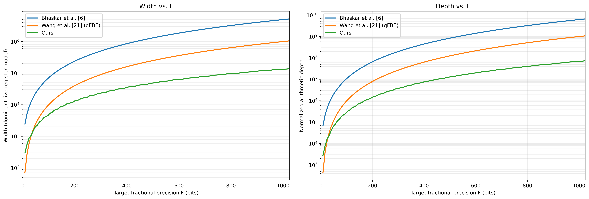
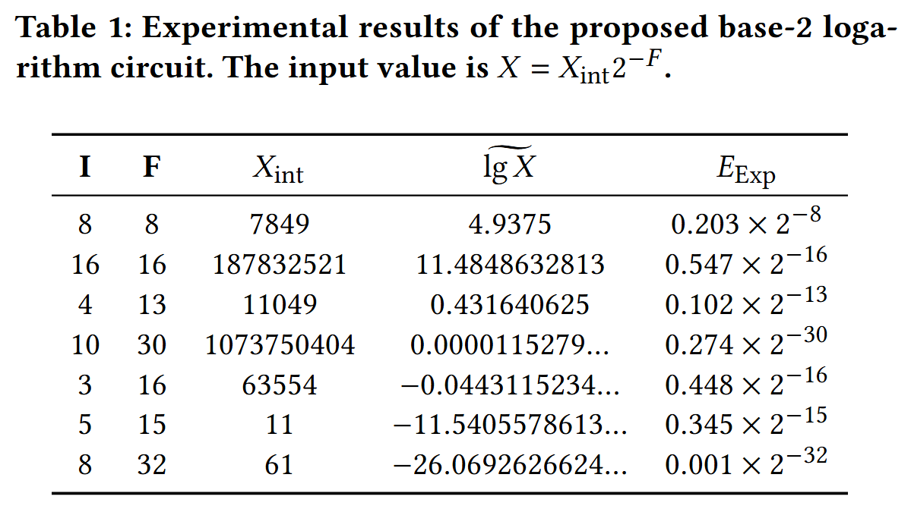

# Supplementary Material for the Quantum Logarithm Circuit

This repository provides the supplementary material for the paper:

**Resource-Efficient Fixed-Point Quantum Logarithm Circuit with Analytically Derived Error Bounds**

The complete circuit-level error analysis and its derivation are provided in [`Appendix.pdf`](./Appendix.pdf).

## Contents

- `Appendix.pdf`: Detailed error analysis of the proposed fixed-point quantum base-2 logarithm circuit.
- `PIC/Circuit_Width_Depth_versus_F.png`: Primitive-level width and depth comparison with prior quantum logarithm circuits.
- QASM files: Circuit QASM files for the experimental cases listed in `LG_Table_ExperimentalResults.png`.

## Resource-Scaling Comparison

To provide a more concrete comparison with prior quantum logarithm circuits, we estimate the resource usage from the number and operand widths of the dominant SQRT and MUL operations, rather than directly plotting their asymptotic Big-O expressions.

The comparison uses target fractional precision `F = 8 ... 1024`.

For the primitive-level depth model, we use

```text
D_SQRT(w) = q(q + 1),  q = ceil(w / 2)
D_MUL(w)  = w^2
```

where the SQRT model reflects the progressively increasing ADD/SUB widths of a non-restoring square-root circuit.

<p align="center">
  
</p>

The left panel shows the estimated width and the right panel shows the normalized arithmetic depth. These figures are primitive-level resource estimates rather than exact Clifford+T counts.

For Bhaskar et al., the number of range-reduction steps `ell` is selected from their analytical error bound to satisfy `2^(-F)` accuracy, with

```text
b = max(5 ell, 25).
```

The estimated resources are

```text
D_Bhaskar
  = D_SQRT(n)
  + (ell - 1) D_SQRT(b + 1)
  + D_MUL(b + 1)

W_Bhaskar
  = n + ell(b + 1) + 2(b + 1).
```

For Wang et al.'s qFBE-based logarithm, an `F`-bit arithmetic state requires approximately `F - 1` square operations:

```text
D_Wang = (F - 1) D_MUL(F)
W_Wang = (F - 1)F + 2F.
```

For the proposed circuit,

```text
M = N = ceil(sqrt(F + 2))
p = F + M + 5.
```

Each SQRT operates on `2p + 2` bits, while each MUL takes two `p + 2` bit operands and temporarily produces a `2p + 4` bit full product. Therefore,

```text
D_LG
  = M D_SQRT(2p + 2)
  + N D_MUL(p + 2)

W_LG
  = M(2p + 2)
  + N(2p + 4).
```

Reusable scratch ancilla are not multiplied by the number of sequential arithmetic operations.

## Experimental QASM Files

The experimental cases are summarized in the following table.

<p align="center">
  
</p>

For each row in the table, the corresponding QASM filename follows the format

```text
LG_I_F_X_int.qasm
```

where:

- `I` denotes the number of integer bits of the input.
- `F` denotes the number of fractional bits of the input and output.
- `X_int` denotes the integer encoding of the fixed-point input value.

For example, a row with `I = 8`, `F = 32`, and `X_int = 61` corresponds to the file

```text
LG_8_32_61.qasm
```

## Additional Parameter-Choice Cases

For the case `LG_8_32_61.qasm`, two additional QASM files are provided to illustrate the effect of unbalanced parameter choices:

- `LG_8_32_61_N2.qasm`: The Taylor order is fixed to N=2, requiring more range-reduction rounds M=17 (MN>=(F+2)).
- `LG_8_32_61_M2.qasm`: The number of range-reduction rounds is fixed to M=2, requiring more Taylor terms N=17 (MN>=(F+2)).

These two cases can still achieve the same target error bound, but they require more circuit resources than the balanced choice. This demonstrates why the proposed parameter selection balances M and N.

Except for these two additional illustrative cases, the experimental QASM files follow the balanced parameter selection described in the paper, namely M=N=Theta(F^0.5).

## Simulation with SliQSim

The provided QASM files can be simulated using **SliQSim**, a high-performance BDD-based quantum circuit simulator.

A typical workflow is:

1. Select the QASM file corresponding to the target case in `LG_Table_ExperimentalResults.png`.
2. Run the selected QASM file using SliQSim.
3. Read the output register `lgX`.
4. Interpret `lgX` using the fixed-point output format described below.

## Output Format

The circuit output register is denoted by `lgX`.

It represents `lgX` in the fixed-point format

Q_{(⌈lg(n+1)⌉+1).F},

where

\(n = I + F\).

Let

m = ⌈lg(n+1)⌉+1.

Then the output register `lgX` contains \(m+F\) bits:

```text
lgX = [integer part: m bits][fractional part: F bits]
```

That is, the last \(F\) bits are the fractional part, and the remaining higher-order bits are the integer part.

---

### References

* **SliQSim Repository**: [https://github.com/NTU-ALComLab/SliQSim](https://github.com/NTU-ALComLab/SliQSim)
